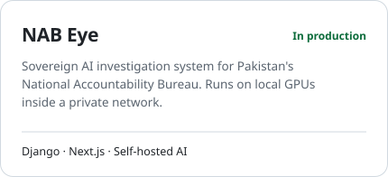
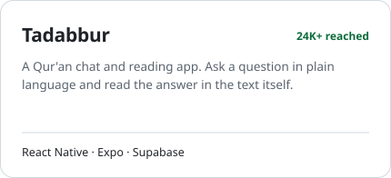
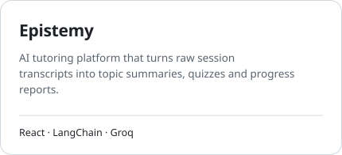
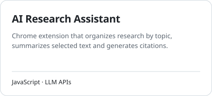

<picture>
  <source media="(prefers-color-scheme: dark)" srcset="./assets/hero-dark.svg">
  
</picture>

I build products end to end and run them reliably in production. I'm a Software Engineer at the [National Center of Artificial Intelligence (NCAI)](https://ncai.pk), where I'm one of the engineers behind NAB Eye, Pakistan's first sovereign AI investigation system.

[Website](https://my-portfolio-three-rust-67.vercel.app) &nbsp;·&nbsp; [LinkedIn](https://www.linkedin.com/in/labibkamran) &nbsp;·&nbsp; [Email](mailto:labibkamran2003@gmail.com)

## Selected work

<a href="https://www.dawn.com/news/2010341"><picture><source media="(prefers-color-scheme: dark)" srcset="./assets/card-nab-eye-dark.svg"></picture></a>
<a href="https://github.com/labibkamran/Tadabbur"><picture><source media="(prefers-color-scheme: dark)" srcset="./assets/card-tadabbur-dark.svg"></picture></a>
<a href="https://github.com/labibkamran/Epistemy-Frontend"><picture><source media="(prefers-color-scheme: dark)" srcset="./assets/card-epistemy-dark.svg"></picture></a>
<a href="https://github.com/labibkamran/AI-Research-Assistant-Frontend"><picture><source media="(prefers-color-scheme: dark)" srcset="./assets/card-research-assistant-dark.svg"></picture></a>

## What I work on

- Cloud infrastructure, CI/CD and Kubernetes. At PlutoSec (Toronto, remote) I cut cloud infrastructure costs by 50%.
- Backend services and platforms in Node.js, Python/Django and Go.
- Full-stack products with React and Next.js, from first prototype to production.
- Right now: open-source infrastructure tooling in Go.

## Experience

| Where | Role | When |
|---|---|---|
| NCAI, NUST | Software Engineer | 2025 to now |
| PlutoSec, Toronto (remote) | Senior Software Engineer, cloud and DevOps | 2025 to now |
| Upwork | Freelance Full-Stack & Cloud Engineer, 100% job success | 2025 to now |
| Codexon Solutions | Full-Stack & DevOps Engineer | 2025 |
| Veron Solutions | Backend Engineer | 2024 to 2025 |
| NUST | BS Computer Science | 2023 to 2027 |

## Stack

 

Open to work on cloud platforms, developer tooling and AI products. The fastest way to reach me is [email](mailto:labibkamran2003@gmail.com).
