<a href="https://my-portfolio-three-rust-67.vercel.app">
  
</a>

  
  
  

I take products from a rough idea to something people rely on: the frontend, the backend, and the cloud infrastructure underneath. Right now I build AI systems at the [National Center of Artificial Intelligence (NCAI)](https://ncai.pk) and work with startups and clients around the world.

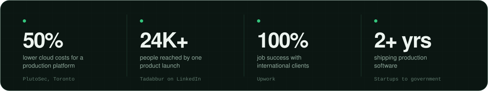

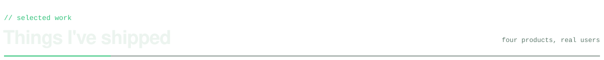

<a href="https://github.com/labibkamran/Tadabbur">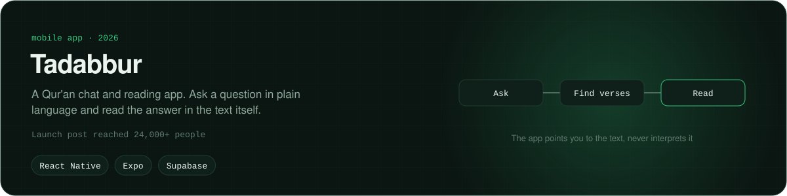</a>

  
  
  

<a href="https://github.com/labibkamran/Epistemy-Frontend">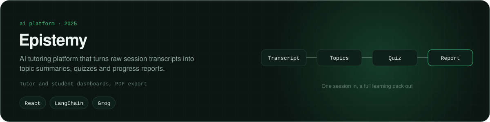</a>

  
  

<a href="https://www.dawn.com/news/2010341">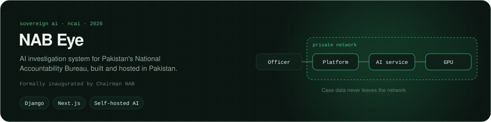</a>

  

<a href="https://github.com/labibkamran/AI-Research-Assistant-Frontend">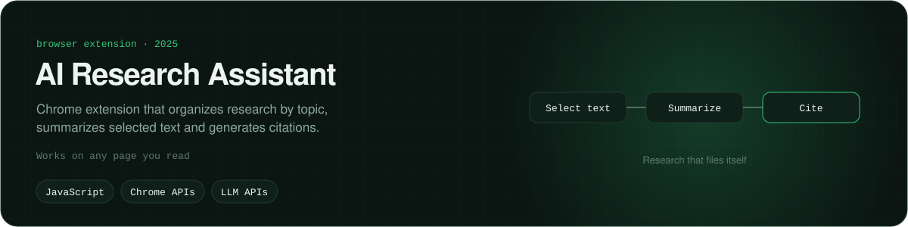</a>

  

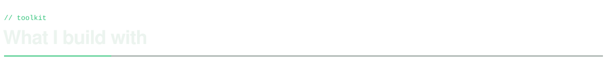
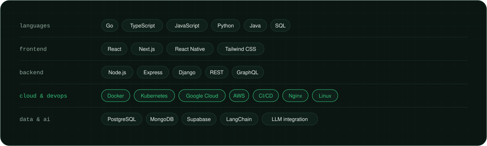

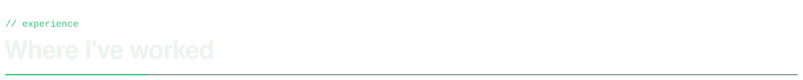
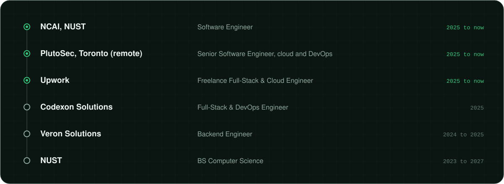

<a href="mailto:labibkamran2003@gmail.com">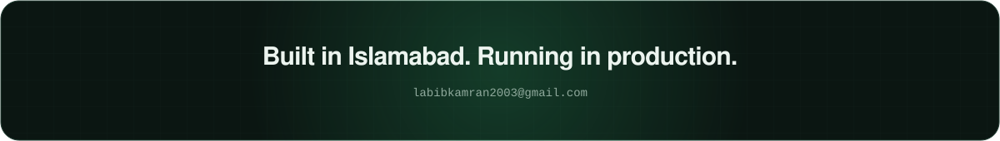</a>
